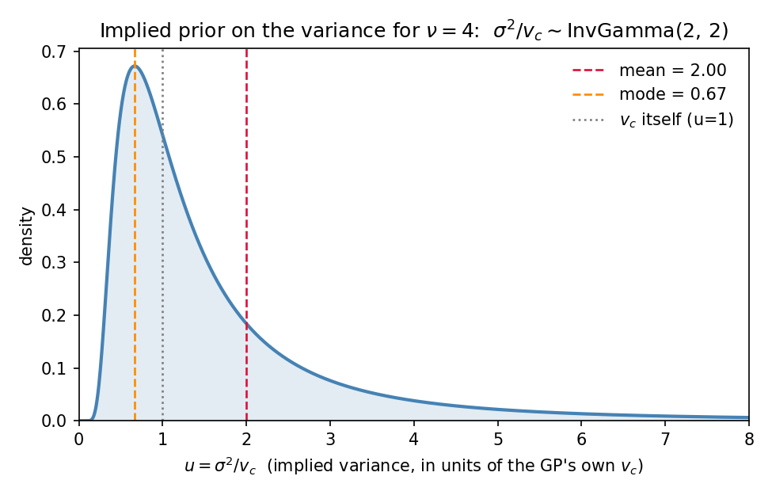
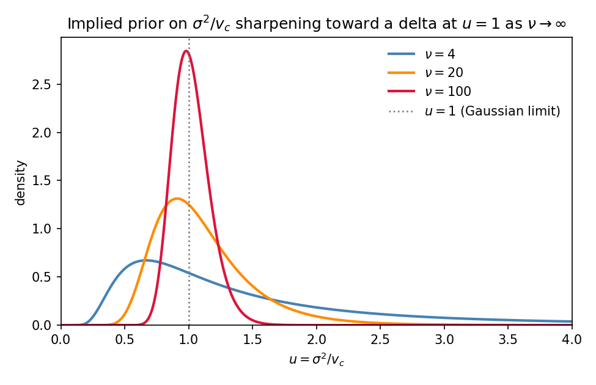

# The Student-t multi-fidelity objective in `zrg_cost_function_student_t`

## What this document covers

The full, explicit scalar function `cost_fn(x)` that L-BFGS-B minimizes over
the 19 free parameters `x` in the MF Student-t runs (e.g.
`configs/aurora_mf_ne128_ne32_prod_studentt_1000starts_annual.yaml`), built
up step by step from `src/autotune_gp/cost.py`'s
`zrg_cost_function_student_t`, with this run's actual configuration
(dof=4, kappa=0, lambda=0, the PCP/OSR/OLR/TLWP weights) plugged in
throughout, not left as symbols.

## Step 0 — the actual starting point: the Student-t density

**What `v_c` actually is, before anything else:** it is the GP's own
*posterior predictive variance* at the candidate point `x`, for one
specific (location, variable) pair — `m, v = gp.predict(x)`, then
`v_c = max(v, var_floor)`. It is **not** the GP kernel's variance
hyperparameter (`hyperparameters.pkl`'s `k0_variance`/`k1_variance`, a
single fixed number set once during training) and **not** a model of the
real observational/physical noise (there is no separate `var_obs` term
anywhere in this cost — see the earlier discussion on whether observation
error should be accounted for). It is specifically the GP's own
*uncertainty about its own prediction* at this particular `x` — small near
training data, large in sparse regions — which is exactly why moving into
a sparse region can inflate `v_c` and is the mechanism the whole
`kappa`/boundary-pinning discussion is about. Mathematically it plays the
*role* of `sigma^2` in the density below; its *source* is GP predictive
uncertainty at a point, not a fixed hyperparameter or a noise model.

Everything in Step 1 is `-log` of one specific, named probability density
— it doesn't start from the already-decomposed cost formula, it starts
from this. For a residual `r` with scale `v_c` and `nu` degrees of freedom,
the (zero-centered, scaled) Student-t density is:

```
p(r | v_c, nu) = [ Gamma((nu+1)/2) / (Gamma(nu/2) * sqrt(nu*pi*v_c)) ]
                 * (1 + r^2/(nu*v_c))^(-(nu+1)/2)
```

`ell(r, v) := -log p(r | v_c, nu)` is, by definition, the cost function's
per-location term. Expanding `-log` of the density directly (log of a
product is a sum of logs; log of a power pulls the exponent out front):

```
-log p(r|v_c,nu)
  = -log[Gamma((nu+1)/2)] + log[Gamma(nu/2)] + log[sqrt(nu*pi*v_c)]
    + (nu+1)/2 * log(1 + r^2/(nu*v_c))

  = -log[Gamma((nu+1)/2)] + log[Gamma(nu/2)] + 0.5*log(nu*pi) + 0.5*log(v_c)
    + (nu+1)/2 * log(1 + r^2/(nu*v_c))            [split log(nu*pi*v_c) apart]

  = const(nu) + 0.5*log(v_c) + 0.5*(nu+1)*log(1 + r^2/(nu*v_c))
```

which is exactly Step 1's `l(r,v)` (minus the `kappa*v_c` term below, which
is *not* part of this density — it's an extra regularization term added on
top afterward, the same role `kappa` plays in the Gaussian-NLL cost, and
the reason `kappa>0` makes this a log-*posterior* rather than a pure
log-likelihood).

### What prior does `nu=4` actually put on the variance itself?

Earlier in this project's history, Student-t was motivated as "Gaussian
with the variance itself uncertain" — a Normal with unknown variance,
given an Inverse-Gamma prior on that variance and marginalized out, is
*exactly* a Student-t. Concretely, if

```
r | sigma^2 ~ N(0, sigma^2),   sigma^2 ~ InverseGamma(shape=nu/2, scale=nu*v_c/2)
```

then marginalizing `sigma^2` out reproduces `p(r|v_c,nu)` from Step 0
exactly — verified numerically (marginalizing the Gaussian over this
Inverse-Gamma prior by quadrature vs. evaluating Step 0's density formula
directly matches to ~1e-7, i.e. numerical-integration noise, at several
values of `r`).

**For this run's `nu=4`:** shape=2, scale=`2*v_c`. In units of `u =
sigma^2/v_c` (so the plot below doesn't depend on the actual, data-specific
value of `v_c`), that's `u ~ InvGamma(2, 2)`, with **mean 2** and **mode
0.67** — the implied belief is that the *true* variance is typically a
couple of multiples of the GP's own `v_c`, not equal to it, and is
noticeably right-skewed (a small chance of a much larger true variance,
very little chance of a much smaller one). One more fact worth knowing:
the variance *of this variance prior itself* is undefined (infinite) at
exactly `nu=4` — `Var[InvGamma(alpha,beta)]` requires `alpha>2`, and here
`alpha=nu/2=2` sits right at that boundary. That's not a coincidence:
Student-t's kurtosis is finite only for `nu>4`, so `nu=4` is exactly the
edge of "how heavy a tail you can have while the *second* moment of the
tail's own uncertainty still exists."



### One prior per call, and what happens as `nu -> infinity`

This prior is not global — it's a separate `InvGamma(nu/2, nu*v_c/2)`
implicitly assumed at *every individual* `(location, variable)` evaluation
of `ell(r,v)`, since `v_c` is different at every one of the 88 cells (and
changes again every time the optimizer evaluates a new `x`, since `v_c`
comes fresh from `gp.predict(x)` each time). Only the shape (`alpha=nu/2`)
is shared globally; the scale tracks whatever `v_c` the GP outputs at that
specific cell.

As `nu -> infinity`, this per-call prior collapses to a delta function at
`u=1` — i.e. "the true variance *is* `v_c`, with no uncertainty", which is
exactly the assumption a plain Gaussian makes. Mean and mode both converge
to 1, and the spread shrinks to 0:

| `nu`    | mean(u) | mode(u)  | std(u) |
|---------|---------|----------|--------|
| 4       | 2.000   | 0.667    | infinite (undefined below `nu=4`) |
| 20      | 1.111   | 0.909    | 0.393  |
| 100     | 1.020   | 0.980    | 0.147  |
| 1,000   | 1.002   | 0.998    | 0.045  |
| 100,000 | 1.00002 | 0.99998  | 0.004  |

(`mean(u) = nu/(nu-2) -> 1`, `mode(u) = nu/(nu+2) -> 1`, `std(u)` requires
`nu>4` to exist at all and shrinks like `~sqrt(2/nu) -> 0` — this is the
same `nu -> infinity` convergence proved algebraically for the cost term a
few pages on, viewed here from the prior side instead of the NLL-formula
side.)



### Integrating over the variance vs. taking `nu -> infinity` — not the same operation

It's tempting to think "Student-t comes from marginalizing something out, so
maybe marginalizing `nu` itself gets back to Gaussian." It doesn't — the two
directions of this connection are different *kinds* of operation:

- **Integrating over `sigma^2`, at fixed `nu`,** is what turns a Gaussian
  into a Student-t (the derivation above). `nu` is not being integrated over
  here — it is the fixed hyperparameter that shapes the InvGamma prior being
  integrated against.
- **Taking the limit `nu -> infinity`** is what turns a Student-t back into
  a Gaussian ("Why the limit is exact" below). This is a limit, not an
  integral — there is no `p(nu)` being summed or integrated against; it's a
  single sequence of distributions converging to one endpoint.

If you instead put a prior `p(nu)` on `nu` and integrated *that* out —
`integral Student-t(r; nu) * p(nu) dnu` — you would generally **not** get a
Gaussian back. Every finite-`nu` Student-t already has heavier-than-Gaussian
tails, and mixing distributions together can only preserve or worsen tail
weight, never lighten it. The only `p(nu)` for which this integral collapses
to a Gaussian is a point mass at `nu = infinity` — which isn't really an
integration, it's the same limit again, just written with an integral sign.

### The Bayesian hierarchical model, written out fully

Putting Step 0's marginalization in standard likelihood / prior / marginal
notation, for one `(location, variable)` call, with `nu` fixed and `v_c` the
GP's own predictive variance at that call:

```
Likelihood:   r | sigma^2  ~  Normal(0, sigma^2)
Prior:        sigma^2      ~  InverseGamma(alpha = nu/2, beta = nu*v_c/2)
Marginal:     r            ~  Student-t(nu, scale^2 = v_c)
              p(r | v_c, nu) = integral Normal(r | 0, sigma^2)
                                 * InvGamma(sigma^2 | nu/2, nu*v_c/2) d(sigma^2)
```

`v_c` plays the role of the InverseGamma prior's central reference point:
`u=1` (i.e. `sigma^2 = v_c`) is the value representing "the true variance
equals `v_c` exactly." The prior's actual mode sits slightly below that, at
`nu/(nu+2) * v_c` (recall the `nu=4` case above: mode `0.667 * v_c`, not
`v_c`) — it only converges to `v_c` as `nu -> infinity`. `nu` controls how
tightly that belief is held — large
`nu` means "very confident `v_c` is the true variance" (the prior
concentrates on `sigma^2 = v_c`, recovering the plain-Gaussian assumption in
the limit), small `nu` means "not very confident; the true variance on any
given call could plausibly be quite different from `v_c`."

This is the same fact as the "one prior per call" section above, just
written in the form a Bayesian reader would expect: `l(r,v) = -log
p(r|v_c,nu)` is a *marginal* (variance-integrated-out) negative
log-likelihood, not a joint density over `(r, sigma^2)`. The optimizer never
sees or estimates `sigma^2` itself — only the already-marginalized `r` term,
with all of the variance-uncertainty already baked in through the
integration above.

## Step 1 — the per-location Student-t NLL term

Restating the result of Step 0 with the optional variance-penalty term
included:

```
l(r, v) = 0.5*log(v_c)                              <- normalization
        + 0.5*(nu+1)*log(1 + r^2/(nu*v_c))           <- fit term
        + const(nu)                                  <- fixed, nu-dependent only
        + kappa*v_c                                  <- optional variance penalty, NOT part of -log p(r)
```

where `v_c = max(v, var_floor)`, `var_floor = 1e-6`, and

```
const(nu) = -lgamma((nu+1)/2) + lgamma(nu/2) + 0.5*log(nu*pi)
```

is the Student-t normalizing constant — fixed once `nu` (degrees of
freedom) is chosen, independent of the residual or the variance. It doesn't
affect where the minimum is (adding a constant doesn't move an argmin) but
makes the returned value a true negative log-likelihood.

**This run's numbers:** `nu = 4`, `kappa = 0`. The `kappa*v_c` term
vanishes entirely, and `const(4) = -lgamma(2.5) + lgamma(2) + 0.5*log(4*pi)
≈ -0.2847 + 0 + 1.2655 ≈ 0.9808`. So for this run the per-location term is
exactly:

```
l(r, v) = 0.5*log(v_c) + 2.5*log(1 + r^2/(4*v_c)) + 0.9808
```

As `nu -> infinity` this expression converges exactly to the Gaussian NLL
term `0.5*r^2/v_c + 0.5*log(2*pi*v_c)` — Student-t is not a different family
bolted on, it's the same Gaussian-variance idea with heavier tails, and
recovers Gaussian exactly in the limit. The two `nu`-dependent pieces (the
fit term and `const(nu)`) each converge separately; here is why.

### Why the limit is exact

The classical fact this is proving is that the Student-t *density* itself
converges pointwise to the Gaussian density as `nu -> infinity`:
`p(r|v_c,nu) -> (1/sqrt(2*pi*v_c)) * exp(-r^2/(2*v_c))`. Since `-log` is
continuous wherever a density is positive, that convergence carries
straight through to `l(r,v) = -log p(r|v_c,nu)` from Step 0 — the algebra
below is just making that carry-through explicit, term by term, rather
than asking you to take the density-level fact on faith.

**The fit term.** Let `x = r^2/(nu*v_c)`, which -> 0 as `nu -> infinity` for
fixed `r, v_c`. Using `log(1+x) = x - x^2/2 + O(x^3)`:

```
0.5*(nu+1)*log(1 + r^2/(nu*v_c))
  = 0.5*(nu+1)/nu * r^2/v_c  -  0.5*(nu+1)/nu^2 * r^4/(2*v_c^2) + O(1/nu^2)
  = 0.5*(1 + 1/nu) * r^2/v_c - O(1/nu)
  -> 0.5 * r^2/v_c        as nu -> infinity
```

the `1/nu` correction vanishing, leaving exactly the Gaussian squared-error
term.

**The normalizing constant.** This one is less obvious because it has three
pieces that individually blow up or vanish — two log-Gamma terms that both
grow, and a `0.5*log(nu*pi)` term that grows too — and the claim is that
they cancel down to a single finite number. Using Stirling's series,
`lgamma(z) = (z - 1/2)*log(z) - z + 0.5*log(2*pi) + O(1/z)`, with `x = nu/2`:

```
lgamma(x)     = (x - 1/2)*log(x) - x + 0.5*log(2*pi) + O(1/x)
lgamma(x+1/2) = x*log(x) - x + 0.5*log(2*pi) + O(1/x)     [expand log(x+1/2) = log(x) + 1/(2x) + O(1/x^2)]

lgamma(x) - lgamma(x+1/2) = -0.5*log(x) + O(1/x)
```

so, with `x = nu/2`:

```
-lgamma((nu+1)/2) + lgamma(nu/2) = -0.5*log(nu/2) + O(1/nu)
                                  = -0.5*log(nu) + 0.5*log(2) + O(1/nu)
```

Adding the third piece, `0.5*log(nu*pi) = 0.5*log(nu) + 0.5*log(pi)`, the
`log(nu)` terms cancel exactly:

```
const(nu) = [-0.5*log(nu) + 0.5*log(2)] + [0.5*log(nu) + 0.5*log(pi)] + O(1/nu)
          = 0.5*log(2) + 0.5*log(pi) + O(1/nu)
          = 0.5*log(2*pi) + O(1/nu)
```

which is exactly the Gaussian normalizing constant — so
`0.5*log(v_c) + const(nu) -> 0.5*log(v_c) + 0.5*log(2*pi) = 0.5*log(2*pi*v_c)`,
matching the Gaussian NLL's normalization term exactly, with the two
`log(nu)` divergences cancelling each other rather than either side
blowing up.

**Numerically** (not just asymptotically — this is where the O(1/nu) error
actually lands):

| `nu` | `const(nu)` | `0.5*log(2*pi)` | diff |
|---|---|---|---|
| 4       | 0.980829 | 0.918939 | 6.19e-02 |
| 100     | 0.921438 | 0.918939 | 2.50e-03 |
| 10,000  | 0.918964 | 0.918939 | 2.50e-05 |
| 1e6     | 0.918939 | 0.918939 | 2.51e-07 |

diff shrinking by ~100x every time `nu` grows 100x confirms the `O(1/nu)`
error term directly.

## Step 2 — mean over locations, within one block, one variable

`l` is computed at every (zonal band, region, global point) location. Within
one ZRG block (zonal, or regional) and one variable, the per-location values
are averaged — a plain mean here, since `zonal_weights` and
`regional_weights` are both `null` in this config. The global block has a
single location, so no averaging is needed there — it's just `l` evaluated
once.

Zonal and regional locations are never pooled into the same mean — they are
sliced apart before any averaging happens (see the ZRG feature layout:
`[zonal_0 ... zonal_14, region_0 ... region_5, global]`).

## Step 3 — weighted sum over the 4 variables

At each block level (zonal, regional, global), the per-variable means are
combined via a weighted sum:

```
zonal_block    = sum_v  w_v * mean_l_zonal(v)
regional_block = sum_v  w_v * mean_l_regional(v)
global_block   = sum_v  w_v * l_global(v)
```

**This run's weights** (`weights.variables` in the config):

| Variable | Weight |
|---|---|
| PCP  | 0.3 |
| OSR  | 0.1 |
| OLR  | 0.3 |
| TLWP | 0.3 |

(OSR downweighted relative to the other three, per an earlier request in
this project's history.)

## Step 4 — weighted sum over zonal / regional / global

```
snap_cost = zrg_w_zonal * zonal_block + zrg_w_regional * regional_block + zrg_w_global * global_block
```

**This run's weights** (`weights.zrg`): zonal = regional = global = 1/3
each. This is a fixed 3-way split, not proportional to how many locations
are in each group — without it the 15 zonal bands would numerically
dominate the 6 regions and especially the single global point, just by
outnumbering them.

## Step 5 — weighted sum over snapshots

```
total_cost = sum_snapshots  dy_w[snapshot] * snap_cost[snapshot]
```

This run has one snapshot (`ANN`, weight 1.0), so this step is a no-op:
`total_cost = snap_cost`.

## Step 6 — the training-distance penalty (inert in this run)

The full `cost_fn(x)` used by the optimizer adds one more term on top:

```
cost_fn(x) = total_cost + lambda * max(0, d(x) - tau)
```

where `d(x)` is `x`'s Euclidean distance (in each parameter's own
`bounds_from_data`-rescaled space) to the nearest real training-ensemble
member, and `tau` is the training ensemble's own worst-case internal
spacing (see `docs/` — or the parameter-uncertainty conversation — for the
full derivation of this penalty). **This run sets `lambda = 0`**, so this
term is identically zero for every `x` — it does not affect this run's
optimization at all, but is included here because it is structurally part
of every call to `cost_fn`.

## The full assembled objective

Putting Steps 1-6 together, this is exactly what `cost_fn(x)` computes at
every L-BFGS-B iteration, for this run's configuration:

```
cost_fn(x) =
    (1/3) * sum_v w_v * mean_{15 zonal bands}    [ 0.5*log(v_c) + 2.5*log(1 + r^2/(4*v_c)) + 0.9808 ]
  + (1/3) * sum_v w_v * mean_{6 regions}          [ 0.5*log(v_c) + 2.5*log(1 + r^2/(4*v_c)) + 0.9808 ]
  + (1/3) * sum_v w_v *                            [ 0.5*log(v_c) + 2.5*log(1 + r^2/(4*v_c)) + 0.9808 ]_global
```

where `(m(x), v(x)) = gp.predict(x)` is the multi-fidelity AR1 GP's
high-fidelity posterior mean and variance at `x`, `r = m(x) - obs` at each
location, `v_c = max(v(x), 1e-6)`, and `w_v` are the PCP/OSR/OLR/TLWP
weights from the table above. This single scalar is what all 1000 L-BFGS-B
starts are independently minimizing over the 19 free parameters.

## This run's configuration, at a glance

| Setting | Value |
|---|---|
| Likelihood | `student_t` |
| Degrees of freedom (nu) | 4 |
| Variance floor | 1e-6 |
| Variance penalty (kappa) | 0 (off) |
| Training-distance penalty (lambda) | 0 (off) |
| Variable weights | PCP 0.3, OSR 0.1, OLR 0.3, TLWP 0.3 |
| ZRG weights | zonal 1/3, regional 1/3, global 1/3 |
| n_xstarts | 1000 |
| max_workers | 192 |

## References

- Rasmussen, C. E., & Williams, C. K. I. (2006). *Gaussian Processes for
  Machine Learning*. MIT Press. Chapter 2 gives the fit-term-plus-
  normalization structure this per-location term generalizes.
- Gneiting, T., & Raftery, A. E. (2007). Strictly proper scoring rules,
  prediction, and estimation. *JASA*, 102(477), 359-378. Why both terms
  (fit + normalization) must be present for the score to be proper.
- Student-t as a Gaussian scale mixture: a Normal distribution with unknown
  variance, given an Inverse-Gamma prior on that variance and marginalized
  out, is exactly a Student-t distribution — the mathematical basis for
  reading "switch to Student-t" as "account for uncertainty in the GP's own
  fitted noise/kernel hyperparameters," not an ad hoc robustness patch.
